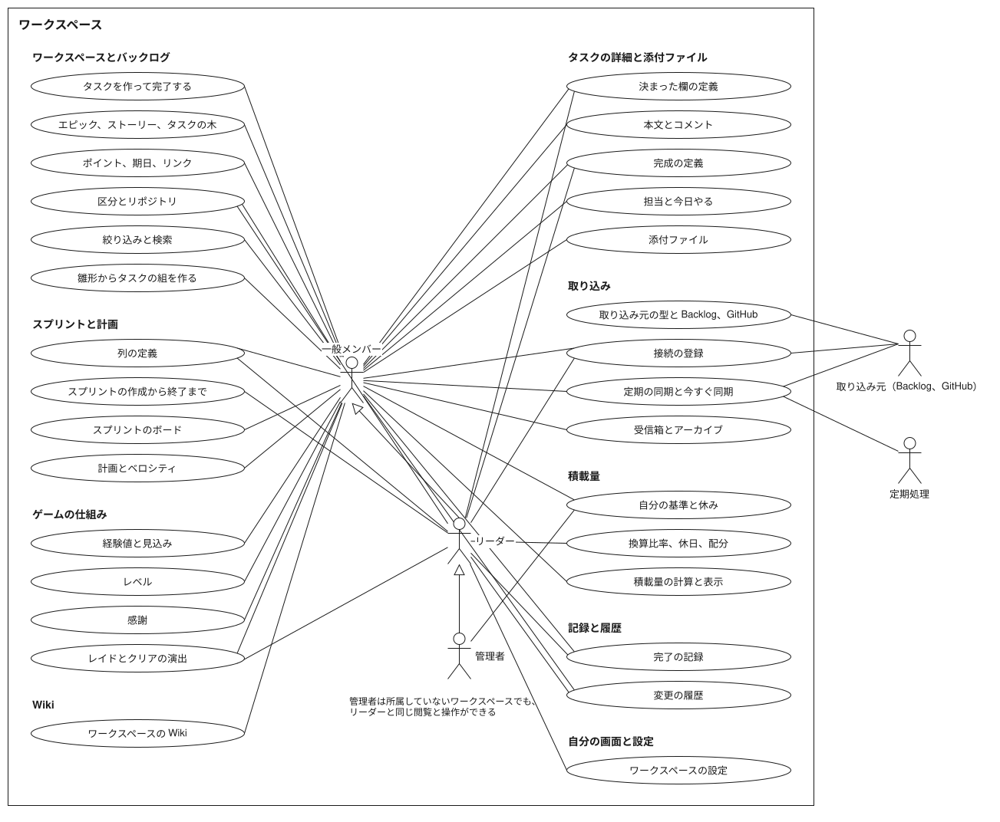
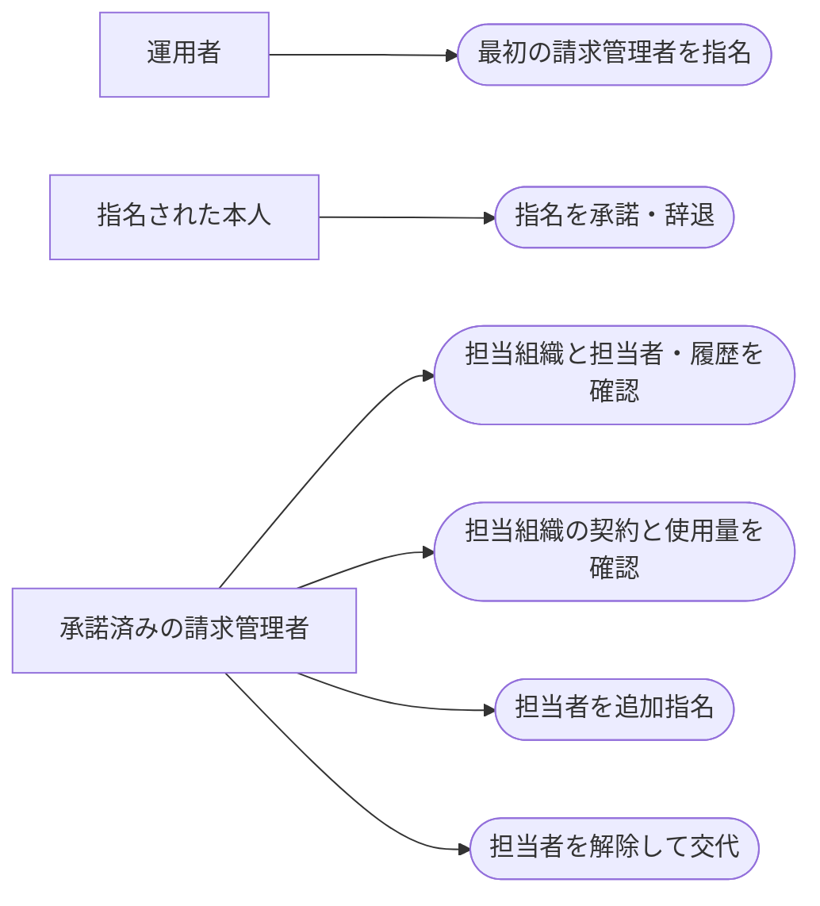

# ユースケース図

誰が何をできるかを、組織の図とワークスペースの図、および業務利用から独立した請求管理の図で示す。既存の組織とワークスペースの2枚の図は `docs/requirements.md`（「組織と運用者」「メンバーと権限」「取り込み」「ゲームの仕組み」「機能」の初版。Wiki は「機能」の「Wiki」）と `.claude/skills/daily-scrum/page/features.json` の写しで、食い違えば文章が正とする。この2枚の楕円の文字は `features.json` の機能の名前そのままとする。後回し、未決、Non-Goals、AI の機能は描かない。請求管理の図は #1240 で実装した権限分離と担当者交代だけを示す。

## 組織の図

## ワークスペースの図

## 組織の外のダッシュボード

会員（ログインした人）は `/` で、入れる組織を選ぶ前に、自分の全組織の今日やることをまとめて閲覧できる（`my-today`、`login` の読み取り）。区分ごとに組織名とワークスペース名つきで並び、行からその組織のタスク詳細へ移る。`/` で完了や今日やるの印を操作することはできない。対象は本人が所属する閉じていないワークスペースで、名前順10組織までを読み、未読の組織数と読めなかった組織を示す。組織・ワークスペースの図の楕円は変更せず、この会員のユースケースを図外に記す。

## アクター

| ロール | `permissionScopes` の名前 | 範囲 | できることの要約 |
| --- | --- | --- | --- |
| ログインした人 | `login` | outside | GitHub か Google でログインし、Google の招待を結ぶ。ログインの後は、全組織のダッシュボードで入れる組織を選び、本人の全組織の今日やることと最近の更新を閲覧して各組織の詳細へ移り、自分用と各組織の所属するワークスペースを見渡してそのバックログへ移り、自分の組織（お試しのチーム用か、1人だけで使う自分用）を作り、自分の情報の取得、ログアウト、API トークンの発行と一覧と取り消し、今のセッションと同時刻以前に作られたほかのセッションとすべてのトークンの無効化（`credentials-revoke-all`）を行う |
| 運用者 | `operator` | outside | 組織を作り、組織の停止と再開、管理者の指名し直し、上限の変更、契約（プランと支払いの周期）の切り替え、最初の請求管理者の指名を行う |
| 請求管理者 | `login` と組織ごとの承諾済み請求権限 | outside | 担当組織の契約・上限・利用の状態と、人数と容量の使用量を確認し、請求管理者を指名・解除し、変更履歴を確認する。組織管理者やメンバーとは独立し、請求専用の人は業務データを閲覧・操作できず利用人数にも数えない |
| 組織に入れる人 | `invitee` | organization | 組織に入り、届いた招待を承諾するか辞退する |
| 組織のユーザー | `organization` | organization | 今日やること、最初にやること、Banmen のニュース、最近の更新、マイプロフィール、通知、お気に入りを使い、組織の Wiki のページを読み書きする |
| 管理者 | `admin` | organization | 組織を管理し、管理者の指名と解除、ユーザーの無効化、ワークスペースの作成を行う。お試しの期限と、契約（プラン）と上限を見る。所属していないワークスペースでもリーダーと同じ閲覧と操作ができる |
| リーダー | `leader` | workspace | 一般メンバーの操作に加え、ワークスペースの設定、スプリントの作成から終了まで、メンバーの管理を行う |
| 一般メンバー | `member` | workspace | タスク、スプリントのボードと計画、自分の接続と取り込み、ゲーム、積載量、記録を使い、ワークスペースの Wiki のページを読み書きする |
| ログインの手段（GitHub） | 副アクター | outside | GitHub でのログインで本人を確かめる |
| ログインの手段（Google） | 副アクター | outside | Google でのログインと、招待の URL からの結び付けで本人を確かめる |
| 取り込み元（Backlog、GitHub） | 副アクター | workspace | 接続を受け、取り込みと同期の相手になる |
| 定期処理 | 副アクター | workspace | 定期の同期を動かす |

汎化は 管理者 → リーダー → 一般メンバー → 組織のユーザー → 組織に入れる人 の順につなぎ、上のロールは下のロールのできることをすべてできる。線は、その機能を使えるロールのうち一番下のロールに引く。1つの機能の中で担い手が分かれるもの（招待するリーダーと承諾する組織に入れる人、設定するリーダーと使う一般メンバーなど）は、担い手ごとに線を引く。

「取り込み元の型と Backlog、GitHub」は取り込み元ごとの違いを閉じ込める型で、人が直に使う操作を持たない。そのため、副アクターの取り込み元にだけ線を引く。人が使うのは、それを通す接続の登録、同期、受信箱である。

## 業務利用から独立した請求管理

請求画面は `/auth/billing`。通常のアカウントでログインし、業務利用できる組織の一覧とは別に担当組織を選ぶ。1人が複数組織、1組織に複数人の請求管理者を置ける。上の管理者から一般メンバーへの汎化に請求管理者は含めず、兼任して初めて両方の権限を持つ。

運用者の初回指名と、本人による承諾を分ける。請求管理者がいない組織では運用者が指名するが、組織管理者であるだけでは指名や承諾済みの権限を得られない。アカウントIDは指名先を特定するために本人から共有してもらい、権限の根拠にはしない。

指名の承諾・辞退は指名された本人だけが行う。担当組織の契約と使用量の確認、担当者の追加・解除と履歴の取得は対象組織の承諾済み請求管理者だけが行い、別の組織を指定しても閲覧・操作できない。交代は、新しい担当者を指名し、本人の承諾後に元担当者を解除する。契約中の最後の承諾済み担当者は解除できず、解除しても組織の契約、データ、業務利用権限を消さない。

請求管理の操作は Cookie のセッションだけで呼び、API トークンからは呼べない。業務データへの API やファイル取得では引き続き業務利用の権限を確かめ、請求専用の人を通さない。ベータの契約の変更・支払いは運用者が扱う。請求管理者に見せる使用量は人数と容量の組織全体の合計だけで、業務データをたどれない（#1241）。決済連携・通知（#1242）は後続に残す。

## 図に描かない制約

本人、作った人、依頼主といった持ち主の制約はアクターにしない。操作の定義の `permission` は粗い門で、持ち主の判定はハンドラにある。たとえば、エピックをクリアできるのは依頼主とリーダー、削除できる（タスクは削除の取り消しも）のは作った人（取り消しは削除した人も）とリーダーである（`docs/requirements.md` の「メンバーと権限」）。自分の接続の登録と編集と削除は本人が行い、他のメンバーの接続の停止と削除はリーダーと管理者が行う（どちらも操作の定義の `permission` は `member` で、持ち主かリーダーかの判定はハンドラにある）。Wiki のページは、組織の人（組織の Wiki）とメンバー（ワークスペースの Wiki）の全員が読み書きでき、消せるのは作った人とリーダー（管理者を含む）で、組織の Wiki にリーダーはいないので作った人と管理者である（`docs/requirements.md` の「機能」の「Wiki」）。管理者が所属していないワークスペースで操作するときは、担当、経験値、積載量の対象から外れる。

API のトークンで呼ぶクライアント（`banmen` を含む）は、発行した本人が画面からできる範囲の操作を呼ぶ。`read` のトークンは読み取りの操作だけを呼べ、運用者の操作、請求管理の操作、ログアウト、トークンの発行と一覧と取り消し、すべてのセッションとトークンの無効化（`credentials-revoke-all`）は、どのトークンからも呼べない（`docs/requirements.md` の「メンバーと権限」）。クライアントはアクターにせず、この注記にとどめる。

パスワードのログインと API トークンの発行は `docs/requirements.md` にあるが、`features.json` の機能の一覧に無いので楕円にしていない。

ワークスペースの図では、一般メンバーから「雛形からタスクの組を作る」に線を引く。雛形の作成・編集・削除はリーダー（管理者を含む）がワークスペースの設定で行う。

組織の管理者は、組織の管理でワークスペースを終了・再開できる。削除を有効にした環境では、終了済みのワークスペースを、その設定ページで名前を確認して削除できる。削除は画面のセッションで行う（`docs/requirements.md` の「メンバーと権限」）。

## 図の直し方

`docs/requirements.md` の「機能」と「メンバーと権限」の権限の表、`docs/ai.md` の「決めること」、`docs/design.md` の「画面一覧」を変える PR は、同じ PR で `features.json` と図も直す（`docs/development.md` の「スクラムのイベントと成果物」）。

図は draw.io（デスクトップか app.diagrams.net）で SVG を開いて直し、同じ形式で書き出す。背景を白で塗り、ラベルは `html=0` にして SVG の文字（`foreignObject` でないもの）で書き出し、図のデータを埋め込む。デスクトップの CLI では `drawio -x -f svg -e -b 10 --theme light -o <名前>.drawio.svg <名前>.drawio` で書き出す。`--theme` を省くと見る側のテーマで色を入れ替える SVG になり、ダークのテーマで背景が黒くなる。

直した後は、`features.json` の `base` 以外で `phase` の無い機能の名前が、2枚の SVG の `<text>` のどれかと、空白と改行を除いて完全に一致することを確かめる。
